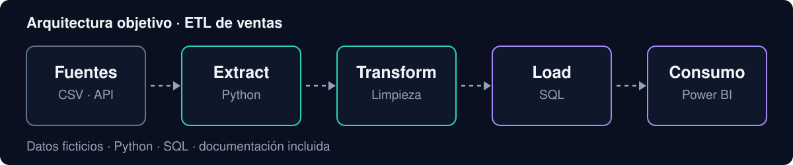

 

## Sobre mí

Soy desarrollador de software con base sólida en datos. Construyo aplicaciones, automatizo procesos y diseño flujos que llevan información desde fuentes desordenadas hasta reportes que alguien usa para decidir.

Mi ruta: **Software & Data → Data Engineering → AI Engineering.**

 

## Áreas de trabajo

| | Qué hago |
|---|---|
| **Data Engineering** | Pipelines ETL/ELT, modelado dimensional, calidad de datos y orquestación. |
| **Analytics Engineering** | Transformaciones en SQL, modelos de datos para análisis y dashboards en Power BI. |
| **Software Development** | Aplicaciones web y APIs con .NET, Angular y Python. |
| **Automation** | Automatización de procesos contables y reportes ejecutivos en Excel. |
| **IA** | Explorando ML aplicado y LLMs para trabajar con datos. |

 

## Tech stack

**Lenguajes** 

**Datos y analítica** 

**Desarrollo** 

**Aprendiendo** 

 

## Proyectos destacados

### ETL de ventas · Python + SQL
`En desarrollo`

- **Qué resuelve:** convierte archivos de ventas sin estructura en una base de datos lista para análisis.
- **Tecnologías:** Python, SQL, Power BI.
- **Resultado:** se documentará al publicar el repositorio (métricas, capturas y consultas).

 

| Proyecto | Qué demuestra | Estado |
|---|---|---|
| **Dashboard de ventas** · Power BI | Modelado de datos, medidas DAX y visualización para decisiones. | `Planeado` |
| **Plataforma de automatización contable** · Flask + JavaScript | Procesamiento de libros contables y generación de reportes ejecutivos en Excel. | `Versión pública en preparación` |

 

## Formación y certificaciones

| | |
|---|---|
| **Formación** | TU CARRERA · TU UNIVERSIDAD |
| **Certificaciones** | TU CERTIFICACIÓN · AÑO |
| **En curso** | TU CURSO ACTUAL |

 

## Contacto

